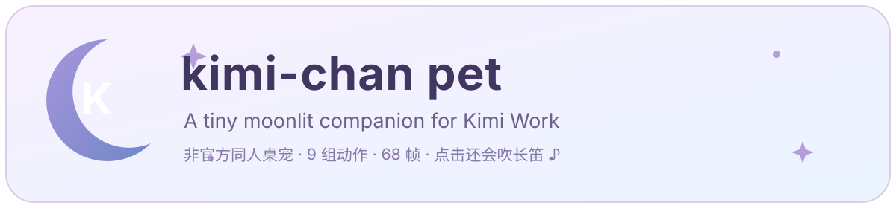
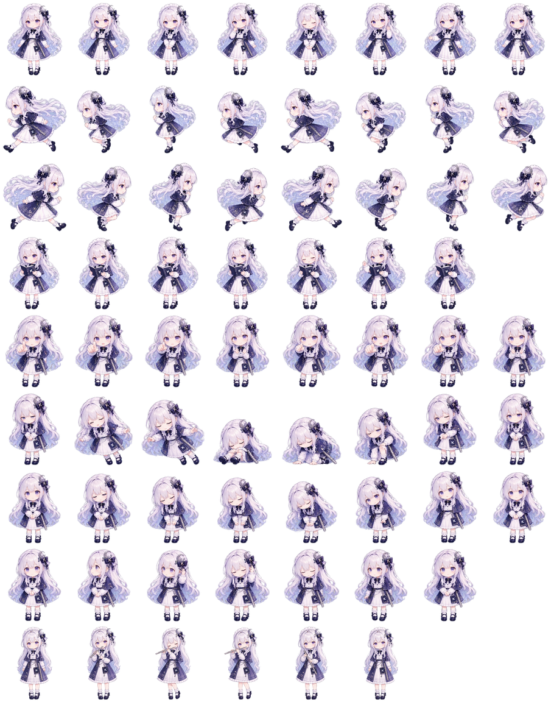

<div align="center">

<picture>
  <source media="(prefers-color-scheme: dark)" srcset="assets/header-dark.svg">
  
</picture>

<p>
  <a href="https://github.com/Momoyeyu/kimi-chan-pet/releases"></a>
  <a href="LICENSE"></a>
  <a href="LICENSE-CODE"></a>
  
</p>

<h3>把一小片月光，放进你的桌面。 🌙</h3>

<p>
她会待命、奔跑、读书、打瞌睡，也会在你需要的时候安静等候。<br>
如果轻轻点她一下，还会掏出自己的长笛，为你演奏一小段。<br>
<b>非官方同人桌宠 · 9 组动作 · 68 帧 · 可爱不商用 ଘ(੭*ˊᵕˋ)੭* ੈ✩‧₊˚</b>
</p>

<table>
  <tr>
    <td align="center"><b>日常待机</b></td>
    <td align="center"><b>长笛时间</b></td>
  </tr>
  <tr>
    <td align="center"></td>
    <td align="center"></td>
  </tr>
</table>



</div>

## ✨ 她会做什么

| 动作 | 帧数 | 什么时候出现 |
| --- | ---: | --- |
| `idle` | 8 | 日常待机、轻轻呼吸与眨眼 |
| `running_left` | 8 | 向左拖动 |
| `running_right` | 8 | 向右拖动 |
| `working` | 7 | 会话正在运行，认真读书中 |
| `waiting` | 8 | 等待审批或选择 |
| `failed` | 8 | 跌倒再爬起来的兼容动作 |
| `idle_random_1` | 8 | 偶尔打瞌睡，再悄悄醒来 |
| `idle_random_2` | 7 | 偶尔整理月亮发饰 |
| `flute_playing` | 6 | **可选：左键点击角色，演奏后自动恢复当前状态** |

图集为透明 PNG，尺寸 **2048 × 2592**；每帧 **256 × 288**。安装目录只保留运行必需的 `pet.json` 与 `spritesheet.png`。

## 🌷 带到另一台机器

### 1. 下载安装包

前往 [**Releases**](https://github.com/Momoyeyu/kimi-chan-pet/releases)，下载并解压：

```text
kimi-chan-pet-v1.0.0.zip
```

也可以直接克隆仓库：

```bash
git clone https://github.com/Momoyeyu/kimi-chan-pet.git
```

请使用支持自定义 spritesheet 桌宠的 **Kimi Work** 版本。

### 2. 安装桌宠

在 Kimi Work 中打开解压后的目录，把 `kimi-chan` 文件夹交给 Kimi，并发送：

> 请安装当前目录下 `kimi-chan` 文件夹中的桌宠，并在安装后告诉我结果。

然后前往 **设置 → 桌面宠物**，显示并选择 **「Kimi 娘 · Q 版」**。

> 小提示：桌宠安装目录中只应有 `pet.json` 和 `spritesheet.png`。README、许可证与辅助脚本都放在外层，不需要塞进安装目录。

### 3. 可选：开启“点击吹长笛” ♪

标准动作安装后即可使用；如果还想要点击演奏，在**完成桌宠安装后**运行：

```bash
python3 scripts/enable_flute_click.py
```

脚本会：

- 自动寻找已安装的 `kimi-chan`，不需要猜 widget ID；
- 检查 `flute_playing` 是否存在；
- 备份原 `index.html` 后再插入点击监听；
- 重复执行不会重复打补丁。

macOS 使用默认 Kimi Work 目录；其他环境可显式指定：

```bash
python3 scripts/enable_flute_click.py --widgets-root "/path/to/blueprint/widgets"
```

完成后隐藏再显示桌宠，**左键点击角色区域**即可播放。若系统开启“减少动态效果”，点击动画会保持关闭。

没有运行这个补丁也没关系：原有 8 组动作仍然可用，只是不会触发点击演奏。

## 📦 仓库里有什么

```text
kimi-chan-pet/
├── kimi-chan/
│   ├── pet.json                  # 9 组动作与图集配置
│   └── spritesheet.png           # 透明桌宠图集
├── assets/                       # README 头图、信息卡与动画预览
├── scripts/
│   ├── enable_flute_click.py     # 可选点击互动补丁
│   └── make_previews.py          # 从图集重新生成 GIF 预览
├── LICENSE                       # 美术素材：CC BY-NC 4.0
├── LICENSE-CODE                  # 辅助代码：MIT
├── NOTICE.md                     # 原作者、出处、修改与许可边界
└── README.md
```

<details>
<summary><b>展开完整图集预览</b></summary>



</details>

## 💜 许可与署名

这个项目采用**分文件类型的许可**，既能开放分享，也不越过原作者的要求：

| 内容 | 许可 |
| --- | --- |
| `scripts/` 中本项目编写的辅助代码 | [MIT](LICENSE-CODE) |
| 角色美术、`kimi-chan/` 桌宠素材及 `assets/` 角色预览 | [CC BY-NC 4.0](LICENSE) |

角色形象与原始设计来自 **ZipZipPipe**：

- [哔哩哔哩 @ZipZipPipe](https://space.bilibili.com/4168597)
- [Pixiv @ZipZipPipe](https://www.pixiv.net/users/18604994)
- [《AI娘化》原始立绘合集](https://www.pixiv.net/artworks/148186519)
- [《大AI和小AI们》Q 版设计展示](https://www.bilibili.com/video/BV1tE9XBbErS/)
- [作者关于开放分享与再创作的说明](https://www.bilibili.com/video/BV1bARXBYEZz/)

原作者在 Pixiv 明确写道：**“需要标注作者，不可商用。”** 因此不能把角色素材整体改标为允许商业使用的 MIT 或 Apache 2.0。这里选择 **代码 MIT + 美术 CC BY-NC 4.0**，保留署名与非商业限制。

本项目重新生成并规范化了动画帧，追加长笛动作和可选互动脚本。**这是非官方同人作品，不代表 ZipZipPipe、Moonshot AI／月之暗面或相关厂商的认可、合作或背书。**

完整的出处、修改说明与许可边界请阅读 [`NOTICE.md`](NOTICE.md)。如原作者认为署名或使用方式不妥，欢迎提交 Issue，核实后应及时更正或下架。

---

<div align="center">

愿你的桌面也有一点月光。 🌙<br>
<b>またね～ 记得保留署名，也别把她带去收费摊位哦。</b>

</div>
